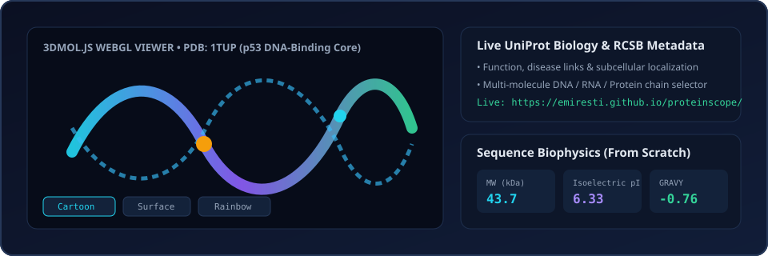

<div align="center">

# 🧬 ProteinScope

### Explore the 3D architecture of life, right in your browser.

Search any protein by name, gene or PDB ID, rotate its structure, read its biology and analyse its sequence — live from RCSB PDB and UniProt.

[](https://emiresti.github.io/proteinscope/)


<br>



</div>

---

## ✨ Features

| | |
|---|---|
| 🔎 **Smart search** | Type a PDB ID (`1TUP`) or free text (`p53`, `hemoglobin`, `insulin`). Free text is searched through the RCSB Search API. |
| 🧊 **Interactive 3D viewer** | Cartoon, sticks, spheres, lines and molecular surface. Color by rainbow, chain, secondary structure or residue type. Hover any atom to identify the residue. |
| 🧪 **Biology panel** | Function, disease associations, subcellular location and keywords pulled live from UniProt. |
| 📊 **Sequence analysis** | Molecular weight, isoelectric point (pI), GRAVY hydropathy, net charge at pH 7, amino-acid composition chart and a colour-coded sequence viewer. GC content for DNA/RNA chains. |
| 🧬 **Multi-molecule entries** | Complexes are split into their molecules (protein, DNA, RNA). Pick one and the biology and sequence panels update. |
| 📸 **Share-ready** | PNG screenshot, fullscreen mode, FASTA copy and deep links such as `…/#4HHB`. |

## 🔬 How the sequence numbers are computed

All calculations are implemented from scratch in `app.js`, with no bioinformatics library.

- **Molecular weight** = sum of average residue masses + one water molecule (18.015 Da).
- **GRAVY** = mean Kyte–Doolittle hydropathy over all residues.
- **Net charge** at a given pH from the Henderson–Hasselbalch equation, using pKa values for the N-terminus, C-terminus and the side chains of K, R, H, D, E, C and Y.
- **Isoelectric point (pI)** = the pH where the net charge is zero, found by bisection (60 iterations).
- **GC content** = (G + C) / length for nucleic-acid chains.

> pKa tables differ between tools, so the pI can deviate slightly from values given by ExPASy or other servers.

## 🌐 Data sources

| Source | Used for |
|---|---|
| [RCSB PDB Data API](https://data.rcsb.org) | Entry metadata, resolution, method, molecules and sequences |
| [RCSB PDB Search API](https://search.rcsb.org) | Free-text structure search |
| [RCSB file server](https://files.rcsb.org) | Atomic coordinates (`.pdb`, falling back to `.cif`) |
| [UniProt REST API](https://rest.uniprot.org) | Protein function, diseases, location, keywords |
| [3Dmol.js](https://3dmol.org) | WebGL molecular visualization |

## 🗂 Project structure

```
proteinscope/
├── index.html   # page layout and controls
├── style.css    # dark "lab" theme, glass cards, animations
├── app.js       # API calls, 3D viewer logic, sequence analysis
├── assets/
│   └── preview.svg
└── README.md
```

No framework, no bundler, no dependencies to install.

## 🚀 Run locally

```bash
git clone https://github.com/emiresti/proteinscope.git
cd proteinscope
```

Then open the folder in VS Code and start it with the **Live Server** extension (right-click `index.html` → *Open with Live Server*).  
Any static server works too, for example `python -m http.server 8000`.

## 🧭 Roadmap

- [ ] Mutation viewer: highlight a residue (e.g. p53 R175) on the structure
- [ ] AlphaFold DB models for proteins without experimental structures
- [ ] Pairwise sequence alignment (Needleman–Wunsch / Smith–Waterman) written from scratch
- [ ] Side-by-side structure comparison
- [ ] Binding-site and ligand contact analysis

## 📚 Credits and references

- Berman HM *et al.* **The Protein Data Bank.** *Nucleic Acids Research* (2000).
- The UniProt Consortium. **UniProt: the Universal Protein Knowledgebase.** *Nucleic Acids Research*.
- Rego N, Koes D. **3Dmol.js: molecular visualization with WebGL.** *Bioinformatics* (2015).
- Kyte J, Doolittle RF. **A simple method for displaying the hydropathic character of a protein.** *J Mol Biol* (1982).

## 👤 Author

**Muhammed Emir Esti** — Molecular Biology & Genetics + Computer Programming student focused on bioinformatics.

[](https://github.com/emiresti)
[](https://www.linkedin.com/in/muhammed-emir-esti)

---

<div align="center">

If you find this useful, a ⭐ on the repo is much appreciated.

</div>
